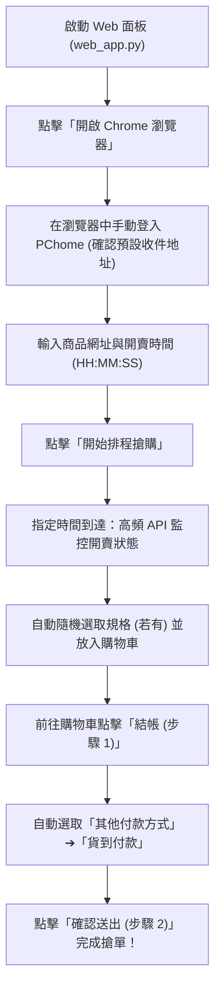

# PChome 24h 自動搶購小幫手 (PChome-AutoBuy)


專為 **PChome 24h 線上購物** 設計的高效能自動搶購輔助工具。配備精美的現代化 **Web 控制面板（Flask GUI）**、**API 即時高頻開賣偵測**、**多規格商品自動隨機選取**、**自動選取貨到付款** 以及 **undetected-chromedriver 防偵測技術**，助您在開賣瞬間快人一步！

---

## ✨ 核心特色

- 🖥️ **直覺的 Web 控制面板**：提供視覺化操作介面（本機 `http://127.0.0.1:5000`），輕鬆填入商品連結、設定排程時間與掌握當前狀態。
- 🕒 **精準定時排程**：指定時間（`HH:MM:SS`）毫秒級倒數，時間一到自動啟動搶購流程。
- ⚡ **高頻 API 監控**：直接對 PChome 官方開賣狀態 API 進行高頻率偵測（預設 0.5 秒），免刷新網頁，搶佔先機。
- 🎨 **多規格隨機選取**：若商品包含規格選項（如顏色、尺寸、容量等），程式會自動隨機選擇一個可購買的規格，避免因卡在選取規格而錯失良機。
- 💵 **自動切換「貨到付款」**：結帳時自動選取「其他付款方式」➔「貨到付款」，跳過繁複且容易塞車的信用卡 OTP 簡訊驗證，結帳最迅速！
- 🛡️ **安全無虞（免存帳密）**：支援在開啟的專用瀏覽器中手動登入 PChome，毋須在程式碼或文字檔中留下帳號密碼與付款個資。
- 🤖 **自動匹配 ChromeDriver**：整合 `undetected-chromedriver`，免除手動下載與維護 ChromeDriver 版本的困擾，並有效降低被防爬機制阻擋的風險。
- 🛒 **新版結帳流程適配**：全面適配 PChome 新版雙步驟結帳介面（購物車結帳 `step1` ➔ 確認送出 `step2`）。

---

## 💳 預設結帳付款與運送方式說明

為求以最快速度搶單，本工具採用以下預設結帳策略：

### 1. 付款方式：自動選取「其他付款方式」➔「貨到付款 (COD)」
- **速度優勢**：熱門限量商品在開賣瞬間，信用卡發卡行驗證系統容易塞車或收不到 3D 簡訊驗證碼（OTP）。「貨到付款」在確認送出後直接成立訂單，送達時由物流人員收款取件，速度最快、搶購成功率最高。
- **自動化處理**：
  - 進入結帳頁面時，程式會自動點擊「**其他付款方式**」展開子選單。
  - 自動選定「**貨到付款**」選項（相容下拉選單或單選按鈕）。
  - 若遇相關注意事項或物流手續費提醒對話框，自動點擊「確定」確認。
  - *(備註：若該商品本身不支援貨到付款，程式會印出提醒並保留帳號預設設定，亦可手動快速接手點擊。)*

### 2. 運送方式與收件資料：套用會員帳號預設設定
- **預設運送方式**：由 PChome 24h 依商品特性自動帶入預設物流（通常為宅配）。
- **搶購前關鍵準備**：
  - 請務必在正式搶購前，先至 PChome **「會員中心 ➔ 收件人通訊錄」** 設定好您的常用**收件人姓名、聯絡手機、完整收件地址並設為「預設」**。
  - 事先設妥後，結帳流程中系統便會自動選取預設宅配地址，程式選定貨到付款後即可一鍵直達訂單成立！

---

## 📋 系統需求

- **作業系統**：Windows 10 / 11、macOS 或 Linux
- **Python**：[Python 3.8 或以上版本 (前往官方下載)](https://www.python.org/downloads/) *(⚠️ Windows 安裝時請務必勾選「Add python.exe to PATH」)*
- **瀏覽器**：[Google Chrome 最新版 (前往官方下載)](https://www.google.com/chrome/)

---

## 🚀 快速開始

### 方式一：Windows 一鍵啟動（推薦）

專案內建整合式批次檔，會自動檢查並安裝相依套件：

1. 下載或複製本專案：
   ```bash
   git clone https://github.com/jumpingchu/PChome-AutoBuy.git
   cd PChome-AutoBuy
   ```
2. 雙擊執行目錄下的 **`啟動PChome搶購.bat`**。
3. 批次檔將自動安裝 `requirements.txt` 中缺少的套件，並啟動 Web 服務與自動開啟控制網頁。

---

### 方式二：手動命令列啟動

1. **安裝相依套件**：
   ```bash
   pip install -r requirements.txt
   ```
2. **啟動 Web 控制面板**：
   ```bash
   python web_app.py
   ```
3. 瀏覽器將自動開啟或請手動前往：[http://127.0.0.1:5000](http://127.0.0.1:5000)

---

### 方式三：純腳本 CLI 執行

若您偏好直接使用命令列腳本：
```bash
python pchome_autobuy.py
```
程式會先啟動專用 Chrome 視窗，待您於瀏覽器中登入完成後，在終端機按下 `Enter` 即可開始監控與搶購。

---

## 📖 操作流程指南



1. **開啟專用瀏覽器**：
   - 進入 Web 控制面板後，點擊 **「開啟 Chrome 瀏覽器」**。
   - 程式會呼叫防偵測 Chrome 視窗並自動導向 PChome 首頁。
2. **完成帳號登入與預設資料確認**：
   - 請在該 Chrome 視窗中手動登入您的 PChome 帳號。
   - 💡 **快速進入登入畫面**：若首頁右上角未直接出現登入按鈕，可點選頂部導覽列的 **「顧客中心」**，並點擊選單中的 **「會員設定」**（或「設定」），瀏覽器便會立即跳轉至登入畫面！
   - 建議登入後先確認收件人姓名、聯絡電話、收件地址已設定為「預設」。
3. **設定商品與時間**：
   - 回到 Web 控制面板：
     - **商品網址**：貼上欲搶購的 PChome 24h 商品網址（如 `https://24h.pchome.com.tw/prod/XXXXXX-XXXXXXXXX`）。
     - **開賣時間**：設定搶購目標時間，格式為 `HH:MM:SS`（例如 `11:59:59`）。
4. **啟動排程**：
   - 點擊 **「開始排程搶購」**。
   - 面板將顯示倒數計時狀態。時間一到，系統將每 0.5 秒查詢一次官方按鈕 API，當狀態轉為可購買（`ForSale`）時，立即執行規格隨機選取、加購物車、切換貨到付款與自動送出訂單！

---

## ⚙️ 進階設定 (`config.json`)

程式會自動在根目錄產生並儲存 `config.json`，記錄您的上次輸入：

```json
{
    "url": "https://24h.pchome.com.tw/prod/DDADP3-A900XXXXX",
    "time": "12:00:00",
    "chrome_user_data_dir": "C:\\Users\\<使用者名稱>\\AppData\\Local\\Google\\Chrome\\User Data"
}
```

- `url`：欲搶購的商品網址。
- `time`：排程啟動時間。
- `chrome_user_data_dir`（選填）：若填入本機 Chrome 的使用者資料目錄，可直接使用本機瀏覽器現有的登入狀態與 Cookie，免去每次重新登入。

---

## ❓ 常見問題 (FAQ)

### Q1：如何事先測試搶購流程？
- 建議在正式搶購前，可先找一個有庫存的非限量便宜商品進行流程演練。
- 觀察加入購物車、切換貨到付款與點擊結帳的流程是否順暢。**測試完成後請記得立即取消訂單！**

### Q2：遇到 Chrome 版本更新或 Driver 版本不匹配怎麼辦？
- 本專案採用 `undetected-chromedriver`，啟動時會自動解析您的本機 Chrome 版本並下載配對的 driver。
- 若出現版本警示，程式已內建自動版本捕捉與重啟邏輯；亦可手動更新電腦中的 Chrome 瀏覽器至最新版。

### Q3：多規格商品如何挑選指定款式？
- 目前程式預設為 **隨機挑選一個有庫存的可用規格**，以爭取第一時間成功加入購物車為最高原則。
- 若需鎖定特定關鍵字規格，可自行於 `pchome_autobuy.py` 中的 `select_random_specs()` 函式進行客製化判斷。

### Q4：若商品不支援貨到付款怎麼辦？
- 程式會偵測頁面上的貨到付款選項，若未找到該選項，會印出提醒訊息並繼續維持當前預設付款方式。若有需要，您也可以在彈出的視窗中手動接手點選其他付款方式。

### Q5：若結帳按鈕沒被點擊到該怎麼辦？
- 程式內建防呆機制：若因網頁結構變動未找到結帳按鈕，會自動將當前頁面原始碼儲存為 `error_cart.html` 供後續分析，並暫停讓您可以直接在開啟的瀏覽器中**手動接手點擊結帳**。

---

## ⚠️ 免責聲明 (Disclaimer)

1. 本專案僅供 **Python 網頁自動化技術交流與學術研究** 使用。
2. 嚴禁將本程式用於任何商業牟利、大量囤貨或哄抬價格之黃牛行為。
3. 搶購成功率受限於個人網路延遲、伺服器即時負載、平台防護策略等客觀因素，本專案不保證必定能購得特定商品。
4. 使用本程式所產生之一切行為及後果由使用者自行承擔。

---

## 📄 授權條款 (License)

本專案基於 [MIT License](LICENSE) 條款開源發布。
