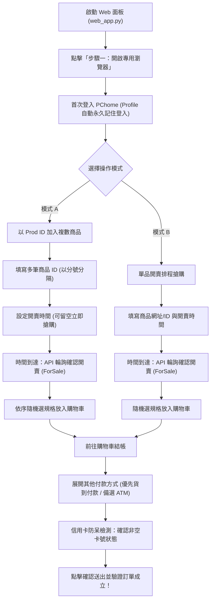

# PChome 24h 自動搶購小幫手 (PChome-AutoBuy)


專為 **PChome 24h 線上購物** 設計的高效能自動搶購輔助工具。配備現代化 **Web 控制面板（Flask GUI）**、**Prod ID 複數商品批次加車**、**時間到確認開賣（ForSale）驗證**、**智能付款選取（貨到付款優先 + ATM 備選）**、**瀏覽器登入狀態永久記憶** 以及 **undetected-chromedriver 防偵測技術**，助您在開賣瞬間快人一步！

---

## 核心特色

- **支援 Prod ID 複數商品批次快速結帳**：提供專屬輸入框，以分號（`;`）分隔多個商品編號（Prod ID），程式自動依序選規格加入購物車並一鍵結帳！
- **時間到確認開賣（ForSale）嚴格驗證**：毫秒級倒數至指定開賣時間，時間一到直接對官方按鈕 API 進行高頻偵測（每 0.3 秒），**嚴格確認狀態轉為 ForSale（已開賣）後才加車結帳**，未開賣絕不盲目點擊！
- **瀏覽器登入狀態永久記憶（免每次登入）**：預設啟用專屬 `chrome_profile/` 目錄，**只需手動登入一次 PChome**，之後每次啟動自動保持已登入狀態，完全不與平日使用的 Chrome 衝突。
- **智能付款選取（貨到付款優先 + ATM 轉帳備選）**：
  - 精確鎖定並展開「其他付款方式」➔ 自動選取「貨到付款 (COD)」，跳過信用卡 3D OTP 簡訊塞車。
  - **自動備選機制**：若遇商品本身不支援貨到付款（如箱裝重物、特定專櫃美妝），自動秒切換至 **「ATM 轉帳」**（生成專屬虛擬帳號先搶下訂單，事後再轉帳）。
  - **信用卡可見度安全鎖**：若付款方式未切換成功（信用卡欄位仍顯示），程式立即安全煞車暫停送出，絕不盲目送出與誤報！
- **直覺的雙模式 Web 控制面板**：提供精美的視覺化操作介面（本機 `http://127.0.0.1:5000`），輕鬆切換「複數商品快速結帳」與「單品排程搶購」。
- **多規格隨機選取**：若商品包含規格選項（如顏色、尺寸、容量等），程式會自動隨機選擇一個可購買的規格，避免卡在選取規格錯失良機。
- **自動匹配 ChromeDriver**：整合 `undetected-chromedriver`，自動解析本地 Chrome 版本並防範被反爬蟲機制阻擋。

---

## 結帳付款與運送方式策略

為求以最快速度搶單，本工具採用以下預設結帳策略：

### 1. 付款方式策略
1. **優先選取「貨到付款 (COD)」**：
   - 開賣瞬間信用卡發卡行驗證系統極易塞車或延遲收發 OTP 簡訊。「貨到付款」送出後直接成立訂單，速度最快、搶購成功率最高。
2. **自動備選「ATM 轉帳」**：
   - 部分商品（如整箱飲料、生鮮冷鏈、特定專櫃商品）PChome 物流不支援貨到付款。
   - 遇到不支援貨到付款的商品時，程式自動選取「ATM 轉帳」，同樣免填卡號、免簡訊驗證，秒搶下訂單！
3. **實體欄位檢測防呆**：
   - 送出前嚴格確認信用卡號輸入框已被隱藏；若未成功切換，立即停止送出並警報，保留畫面讓使用者手動點選。

### 2. 運送方式與收件資料
- **關鍵準備**：正式搶購前，請務必先至 PChome **「會員中心 ➔ 收件人通訊錄」** 設定好常用**收件人姓名、手機、完整收件地址並設為「預設」**。
- 結帳流程中系統會自動帶入預設宅配地址，程式選定付款方式後即可直達訂單成立！

---

## 系統需求

- **作業系統**：Windows 10 / 11、macOS 或 Linux
- **Python**：[Python 3.8 或以上版本 (前往官方下載)](https://www.python.org/downloads/) *(Windows 安裝時請務必勾選「Add python.exe to PATH」)*
- **瀏覽器**：[Google Chrome 最新版 (前往官方下載)](https://www.google.com/chrome/)

---

## 快速開始

### 方式一：Windows 一鍵啟動（推薦）

專案內建整合式批次檔，會自動檢查並安裝相依套件：

1. 下載或複製本專案：
   ```bash
   git clone https://github.com/jumpingchu/PChome-AutoBuy.git
   cd PChome-AutoBuy
   ```
2. 雙擊執行目錄下的 **`啟動PChome搶購.bat`**。
3. 批次檔將自動安裝缺少套件，並啟動 Web 服務與自動開啟控制網頁。

---

### 方式二：手動命令列啟動 Web 控制面板

1. **安裝相依套件**：
   ```bash
   pip install -r requirements.txt
   ```
2. **啟動 Web 控制面板**：
   ```bash
   python web_app.py
   ```
3. 瀏覽器前往：[http://127.0.0.1:5000](http://127.0.0.1:5000)

---

### 方式三：純命令列腳本 CLI

```bash
python pchome_autobuy.py
```
終端機會提示選擇操作模式（1: 單品排程搶購 / 2: 複數 Prod ID 快速結帳），依提示輸入即可。

---

## 操作流程指南



### 1. 開啟專用瀏覽器並登入（僅需首次）
- 點擊 **「步驟一：開啟專用瀏覽器並完成登入」**。
- 程式會呼叫防偵測 Chrome 視窗並開啟 PChome 首頁。
- **首次使用請手動登入一次**。程式會將 Session 儲存在專屬 `chrome_profile/`，**往後打開自動保持登入狀態**。

### 2. 選擇搶購模式

#### 模式 A：以 Prod ID 加入複數商品（開賣快速結帳）
- **商品編號清單（Prod ID）**：在輸入框中輸入一個或多個商品 ID，**多筆請以分號 `;` 分隔**（亦支援全形 `；` 或換行）：
  ```text
  DGBH1H-A900XXXXX;DDADP3-A900YYYYY;DCAE3L-A900ZZZZZ
  ```
- **開賣時間 (HH:MM:SS)**：設定開賣時間（如 `12:00:00`；留空則立即確認開賣並加車結帳）。
- 點擊 **「步驟二：時間到確認開賣並快速結帳」**：
  1. 倒數至目標時間。
  2. 高頻輪詢（每 0.3 秒）確認商品狀態轉為 **ForSale（已開賣）**。
  3. 依序開啟各商品頁面選取規格加入購物車。
  4. 自動前往購物車切換貨到付款（或備選 ATM）並送出訂單！

#### 模式 B：單品開賣排程搶購
- **商品網址 或 Prod ID**：填入商品網址（如 `https://24h.pchome.com.tw/prod/...`）或直接輸入 Prod ID。
- **開賣時間**：設定開賣目標時間（例如 `11:59:59`）。
- 點擊 **「步驟二：開始定時排程搶購」**。

---

## 設定檔說明 (`config.json`)

程式會自動保存設定於 `config.json`，下次開啟自動帶入上次輸入：

```json
{
    "url": "https://24h.pchome.com.tw/prod/DDADP3-A900XXXXX",
    "time": "12:00:00",
    "multi_prod_ids": "DGBH1H-A900XXXXX;DDADP3-A900YYYYY",
    "multi_time": "12:00:00",
    "mode": "multi"
}
```

---

## 常見問題 (FAQ)

### Q1：如何事先測試搶購流程？
- 建議在正式搶購前，先找 1~2 個有庫存的非限量便宜商品進行流程演練。
- 觀察加入購物車、切換貨到付款（或 ATM）與點擊結帳的流程是否順暢。**測試完成後請記得立即至訂單查詢取消訂單！**

### Q2：如何讓 Chrome 記住登入狀態，不需要每次重新登入？
- 專案已全面啟用專屬 `chrome_profile/` 目錄。只要點擊「開啟瀏覽器」並**登入過一次**，之後關閉重開電腦或重新啟動程式，皆會自動保持登入狀態，不需重複輸入帳密。

### Q3：若商品不支援貨到付款怎麼辦？
- 部分箱裝飲料、特價美妝、生鮮冷鏈等商品受 PChome 物流限制不支援貨到付款。
- 程式內建**智能備選機制**：若未找到貨到付款選項，會自動切換為 **「ATM 轉帳」** 秒搶單（同樣免卡號免 3D 簡訊），避免卡在信用卡填卡號畫面！

### Q4：多規格商品如何挑選指定款式？
- 目前程式預設為 **隨機挑選一個有庫存的可用規格**，以爭取第一時間成功加入購物車為最高原則。

### Q5：遇到 Chrome 版本更新或 Driver 版本不匹配怎麼辦？
- 本專案採用 `undetected-chromedriver`，啟動時會自動解析您的本地 Chrome 版本並下載配對的 driver。

---

## 免責聲明 (Disclaimer)

1. 本專案僅供 **Python 網頁自動化技術交流與學術研究** 使用。
2. 嚴禁將本程式用於任何商業牟利、大量囤貨或哄抬價格之黃牛行為。
3. 搶購成功率受限於個人網路延遲、伺服器即時負載、平台防護策略等客觀因素，本專案不保證必定能購得特定商品。
4. 使用本程式所產生之一切行為及後果由使用者自行承擔。

---

## 授權條款 (License)

本專案基於 [MIT License](LICENSE) 條款開源發布。
